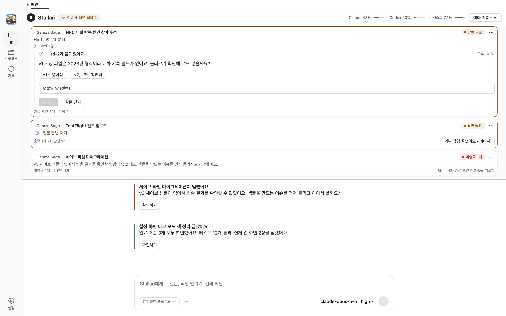

# Knarr

**프로젝트 작업을 대화로 맡기고, 실행 과정과 결과를 확인하는 macOS 앱입니다.**

[Oh My Pi(OMP)](https://github.com/can1357/oh-my-pi)를 AI 실행 엔진으로 연결했습니다. Knarr는 그 위에 프로젝트·이슈 관리, 실행 승인, 대화와 작업 기록 저장, 결과 처리, Mac·모바일 동기화를 구현합니다.



저장소의 예시 프로젝트로 렌더한 화면입니다.

## 어떤 흐름으로 사용하나요?

1. 작업할 프로젝트 폴더를 등록하고 대화로 요청합니다.
2. Stallari가 작업 범위와 완료 조건을 담은 이슈를 준비합니다.
3. 승인된 작업을 Hird가 분리된 Git 작업본에서 수행합니다.
4. 대화와 이슈에서 실행 상태, 질문, 결과와 검증 기록을 확인합니다.

Stallari는 프로젝트 관리 역할, Hird는 코딩 작업 역할의 이름입니다. OMP가 모델 호출과 도구 실행을 담당하고, Knarr는 작업 상태와 기록을 관리합니다.

## 주요 기능

- 프로젝트·이슈별 대화와 작업 상태 관리
- 실행 승인, 진행 기록, 질문과 응답, 중단·재개 흐름
- SQLite 기반 대화·작업 기록 저장
- 작업본과 결과 자료의 보존 및 반영 흐름
- SwiftUI 앱 안의 React 기반 스트리밍 대화 화면
- 로컬 MCP 연결을 통한 프로젝트·이슈 조회와 제안
- CloudKit을 이용한 iPhone·iPad 연결

현재 개발 중인 프로젝트입니다. 공개 버전의 기본 개발 환경은 **Apple Silicon Mac**을 기준으로 안내합니다. iPhone·iPad 연결에는 별도의 Apple 개발팀과 CloudKit 설정이 필요합니다.

## 먼저 살펴보기

macOS 14 이상과 Swift 6 개발 도구가 있으면 모델 계정 없이 소스를 빌드하고 예시 데이터로 화면을 렌더할 수 있습니다.

```sh
swift build -j 2 --product Knarr
swift run -j 2 knarr-snapshot outputs/preview home-light
```

실제 AI 작업을 실행하려면 검증된 OMP 실행 파일과 모델 제공자의 계정 또는 API 연결이 필요합니다. 설치 순서와 로컬 데이터 분리는 [개발 환경 준비](docs/GETTING_STARTED.md)에 정리했습니다.

## 구현에서 다룬 문제

| 주제 | 구현과 검토 지점 |
| --- | --- |
| 실행 상태와 완료 판단 | 요청 접수, 실행 종료, 결과 검증과 반영 상태를 구분합니다. |
| 실행 취소와 복구 | RPC 세션과 소유 프로세스, 저장된 실행 상태를 함께 관리합니다. |
| 기록 보존 | SQLite 저장·이전·실패 처리와 작업 결과 보존을 다룹니다. |
| 긴 대화 표시 | 네이티브 앱과 웹 렌더러 사이의 상태 전달, 스트리밍과 가상화를 다룹니다. |
| 모바일 연결 | Mac에서 실행하고 CloudKit 개인 DB를 통해 상태와 요청을 전달합니다. |

[구조와 코드 읽기](docs/ARCHITECTURE.md) · [테스트와 개발](docs/DEVELOPMENT.md) · [OMP 연결과 패치](docs/OMP_RUNTIME.md)

## 사용 기술

Swift · SwiftUI · AppKit · SQLite · CloudKit · React · TypeScript · OMP RPC

## 라이선스와 외부 소프트웨어

Knarr 자체 코드는 [MIT License](LICENSE)로 제공합니다. OMP와 포함된 외부 소프트웨어에는 각자의 라이선스가 적용됩니다. 출처, 고정 버전, 재사용 범위와 라이선스 원문은 [외부 소프트웨어 고지](docs/THIRD_PARTY_NOTICES.md)에 있습니다.

[개발자 포트폴리오](https://portfolio.soomcha.com) · [GitHub](https://github.com/hks-Khan)
